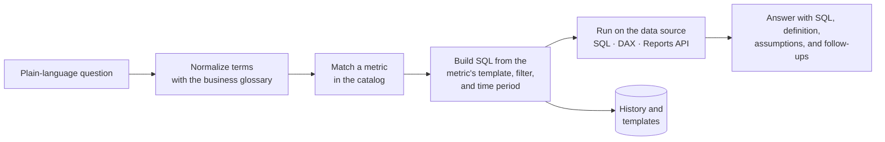

<p align="center"></p>

# AI-Assisted Insights Agent

<p>
  <a href="https://github.com/jkelleman/ai-assisted-insights-agent/actions/workflows/ci.yml"></a>
  
  <a href="https://modelcontextprotocol.io/"></a>
  
  <a href="LICENSE"></a>
  <br>
  
  
  
  
  
  
  
</p>

**An MCP agent that turns plain-language data questions into SQL from trusted metric definitions, runs it on your data platform, and shows its work on every answer.**

Ask "How many active users did we have last week?" and the agent answers with the number, the exact SQL it ran, the metric definition behind it, the filters it assumed, and the questions worth asking next. It's built for stakeholders who need answers without writing SQL, and for analysts who need to trust those answers.

> [!NOTE]
> **Status:** With a config file, the agent runs real queries on SQLite, any SQLAlchemy database, Microsoft Fabric, Databricks, Power BI, or Adobe Analytics, and can report query telemetry to Datadog. A bundled demo warehouse runs end to end with no credentials. Without a config file, answers are **simulated** and labeled that way. Data-quality checks are still simulated for every source. See [Integrations](#integrations) for what's been verified and how.

## Contents

- [The problem](#the-problem)
- [What an answer looks like](#what-an-answer-looks-like)
- [MCP tools and resources](#mcp-tools-and-resources)
- [Integrations](#integrations)
- [Quick start](#quick-start)
- [How it works](#how-it-works)
- [Design principles](#design-principles)
- [Project layout](#project-layout)
- [Roadmap](#roadmap)
- [About](#about)

## The problem

| Who | What goes wrong today |
|---|---|
| **Stakeholders** | They ask "why did revenue drop?" and wait days. When the answer arrives, they can't check how it was calculated. |
| **Analysts** | They rewrite the same queries for routine questions and become the bottleneck. |
| **Everyone** | "Active customers" means different things to different teams, so two dashboards disagree. |

This agent maps business language to one set of trusted metric definitions, then shows the work behind every number, so an answer can be checked instead of taken on faith.

## What an answer looks like

This is real output from `ask_question` with no data source configured, so the number is simulated. With a data source, the note names the source and query time, and the query shown is the exact one that ran.

```text
Question: How many active users did we have last week?
Time Period: last 7 days

Answer: 1,896 users
Note: Values are simulated until a data source is connected.

Query Used:
SELECT COUNT(DISTINCT user_id)
FROM analytics.user_events
WHERE event_type = 'login' AND event_date >= CURRENT_DATE - INTERVAL '7 days'

Explanation:
Metric logic: Unique users who logged in at least once in the time period, from the analytics.user_events table.
Filtered by: event_type = 'login'

Data Quality: (simulated checks)
✓ Data is fresh (updated 2 hours ago)
✓ No missing days in date range
✓ Volume within expected range (within 2σ of baseline)

Metric Definition:
• Name: Active Users
• Description: Unique users who logged in at least once in the time period
• Source: analytics.user_events

Suggested Follow-ups:
• What was active users for the previous period?
• Show me active users broken down by day
• Compare active users to the same period last year
• What's the conversion rate for these users?
```

If a question doesn't match a known metric, the agent doesn't guess. It lists the metrics it knows and suggests how to rephrase.

## MCP tools and resources

| Tool | What it does |
|---|---|
| `ask_question` | Answers a plain-language question with the SQL, metric definition, and follow-ups |
| `generate_query` | Builds SQL for a named metric, time period, filters, and grouping |
| `validate_query` | Checks SQL for structural and performance problems before it runs |
| `explain_result` | Puts a number in context against a baseline and flags notable changes |
| `suggest_followups` | Suggests drill-down and related questions |
| `check_data_quality` | Scores freshness, completeness, and anomalies *(simulated)* |
| `compare_metrics` | Compares two metrics side by side with their definitions |
| `save_query_template` | Saves a query so it can be rerun later |
| `list_templates` | Lists saved templates |
| `run_query` | Runs a read-only SQL query on the connected source. Writes are rejected before they reach the database |
| `transpile_query` | Translates SQL between dialects with SQLGlot, for example PostgreSQL to Fabric T-SQL or Databricks |
| `list_data_sources` | Shows the connected source, its health, and every supported source type |
| `export_powerbi_measures` | Translates the metric catalog into DAX measures for a Power BI semantic model |

**Resources:** `metrics://catalog`, `metrics://metric/{id}`, `history://recent`, `templates://list`, `datasources://current`
**Prompt:** `insights_query_guide`, a short guide to asking good data questions

Full reference: [01_docs/API.md](01_docs/API.md)

## Integrations

Pick one data source in a config file and point `INSIGHTS_CONFIG` at it. Examples for every source are in [`06_configs/config.integrations.example.yaml`](06_configs/config.integrations.example.yaml). Secrets come from environment variables, never from the file.

| Source | How it connects | Install | How it's verified |
|---|---|---|---|
| **Demo warehouse** (SQLite) | SQLAlchemy, with schemas attached so `analytics.*` tables resolve | included | End-to-end tests in CI compare answers to direct database queries |
| **Any SQLAlchemy database** (PostgreSQL, Snowflake, MySQL, ...) | SQLAlchemy URL, with SQL generated for the dialect by SQLGlot | `[postgres]`, `[snowflake]` | Same code path as the demo; dialect output tested with SQLGlot |
| **Microsoft Fabric** (Warehouse or SQL analytics endpoint) | TDS over ODBC, with a Microsoft Entra ID token from `DefaultAzureCredential` | `[fabric]` + ODBC Driver 18 | T-SQL generation tested; not yet run against a live workspace |
| **Databricks** SQL warehouse | `databricks-sqlalchemy` with a personal access token | `[databricks]` | Databricks SQL generation tested; not yet run against a live workspace |
| **Power BI** semantic model | DAX through the `executeQueries` REST API, with an Entra ID token | `[powerbi]` | Requests and responses tested against the documented API; SQL-to-DAX translation tested |
| **Adobe Analytics** report suite | Analytics 2.0 Reports API, with OAuth Server-to-Server sign-in | included | Sign-in, report request, and response parsing tested against the documented API |
| **Datadog** (telemetry, any source) | Metrics API v2: query duration plus success and error counts | included | Request payloads tested; failures never block an answer |

Every SQL source runs only single, read-only `SELECT` statements. SQLGlot parses each query and rejects anything that writes data before it reaches the database.

## Quick start

**Requirements:** Python 3.10+

```bash
git clone https://github.com/jkelleman/ai-assisted-insights-agent.git
cd ai-assisted-insights-agent
pip install -e .
pytest            # 71 tests
```

### Run real queries on the demo warehouse

```bash
python -m insights_agent.demo                        # builds 90 days of synthetic analytics in 03_data/
export INSIGHTS_CONFIG=06_configs/config.demo.yaml   # on Windows: set INSIGHTS_CONFIG=...
python -m insights_agent.cli
```

Ask the same questions; answers now come from the database, and `sources` shows the connection.

### Use it in Claude Desktop

Add the server to `claude_desktop_config.json`. On macOS it's in `~/Library/Application Support/Claude/`, and on Windows it's in `%APPDATA%\Claude\`.

```json
{
  "mcpServers": {
    "insights-agent": {
      "command": "python",
      "args": ["-m", "insights_agent.server"],
      "cwd": "/path/to/ai-assisted-insights-agent",
      "env": { "INSIGHTS_CONFIG": "06_configs/config.demo.yaml" }
    }
  }
}
```

Restart Claude Desktop and ask a data question. Step-by-step setup: [01_docs/CLAUDE_DESKTOP_SETUP.md](01_docs/CLAUDE_DESKTOP_SETUP.md)

### Or use the interactive CLI

```text
python -m insights_agent.cli

insights> ask How many active users did we have last week?
insights> generate revenue "last 30 days"
insights> compare active_users revenue "last month"
insights> transpile fabric SELECT name FROM users LIMIT 5
insights> sources
insights> help
```

CLI reference: [01_docs/CLI_REFERENCE.md](01_docs/CLI_REFERENCE.md)

## How it works



1. **Normalize.** The business glossary maps everyday words to metric terms. For example, "customers" becomes "users" and "sales" becomes "revenue."
2. **Match.** The question is matched against the metric catalog: active users, revenue, conversion rate, and signups.
3. **Generate.** SQL comes from the metric's own template and filter, never improvised, so the same question always gets the same logic. SQLGlot writes it in the source's dialect.
4. **Run.** The connector checks that the query is read-only and runs it, or sends DAX or a Reports API request for Power BI and Adobe Analytics. Timing goes to Datadog if telemetry is on.
5. **Explain.** Every answer carries the query that ran, the definition, the filters it assumed, and suggested next questions.

Design detail: [01_docs/ARCHITECTURE.md](01_docs/ARCHITECTURE.md)

## Design principles

1. **No number without its query.** Showing how a result was calculated is what makes it trustworthy.
2. **Definitions over improvisation.** SQL comes from approved metric definitions, so two people asking the same question get the same answer.
3. **Don't guess.** When a question doesn't match a metric, the agent says so and offers options.
4. **Progressive disclosure.** The answer comes first, then the detail for anyone who wants to check it.
5. **Read-only by construction.** Generated and user-written SQL is parsed and rejected if it would change data.
6. **Honest about limits.** Simulated values and checks are labeled as simulated, every time.

## Project layout

```text
insights_agent/   MCP server, CLI, Pydantic config, SQLGlot SQL layer, telemetry, demo warehouse
  connectors/     SQLAlchemy (SQLite, Fabric, Databricks, any URL), Power BI, Adobe Analytics
05_tests/         71 tests covering parsing, SQL generation, every tool, and every connector
01_docs/          API, architecture, CLI, Claude Desktop setup, data connections, demo walkthrough
02_examples/      Python client, Claude Desktop, Jupyter, and streaming-data examples
03_data/          Sample data for demos
06_configs/       Example configurations
```

## Roadmap

- [x] Load metric definitions and the glossary from a validated config file
- [x] Run generated SQL on real databases, starting with a bundled demo warehouse
- [x] Parse, validate, and translate SQL with SQLGlot
- [x] Connectors for Microsoft Fabric, Databricks, Power BI, and Adobe Analytics, plus Datadog telemetry
- [ ] Verify the Fabric and Databricks connectors against live workspaces
- [ ] Replace simulated data-quality checks with real freshness and completeness queries
- [ ] Add LLM-based question parsing for phrasings the rule-based matcher misses

Connection setup: [Integrations](#integrations) and [01_docs/CONNECTING_TO_DATA.md](01_docs/CONNECTING_TO_DATA.md)

## About

Built by **Jen Kelleman**, a content designer for AI and data experiences. I design how AI systems explain themselves, so people can see why an answer is right before they act on it.

- [LinkedIn](https://linkedin.com/in/jenniferkelleman) · [Portfolio](https://aiwithjen.com) · [AI Content Design Handbook](https://jkelleman.github.io/ai-content-design-handbook/)

**Related projects**
- [Semantic Metrics Modeling Assistant](https://github.com/jkelleman/semantic-metrics-modeling-assistant): an MCP agent for metric governance and trust
- [Airbnb LLM-as-a-Judge Listing Evals](https://github.com/jkelleman/airbnb-llm-as-a-judge-listing-evals): calibrated virtual judges for AI listing highlights
- [AI Content Design Handbook](https://github.com/jkelleman/ai-content-design-handbook): a guide to UX writing for AI systems

Contributions are welcome. See [CONTRIBUTING.md](CONTRIBUTING.md).
